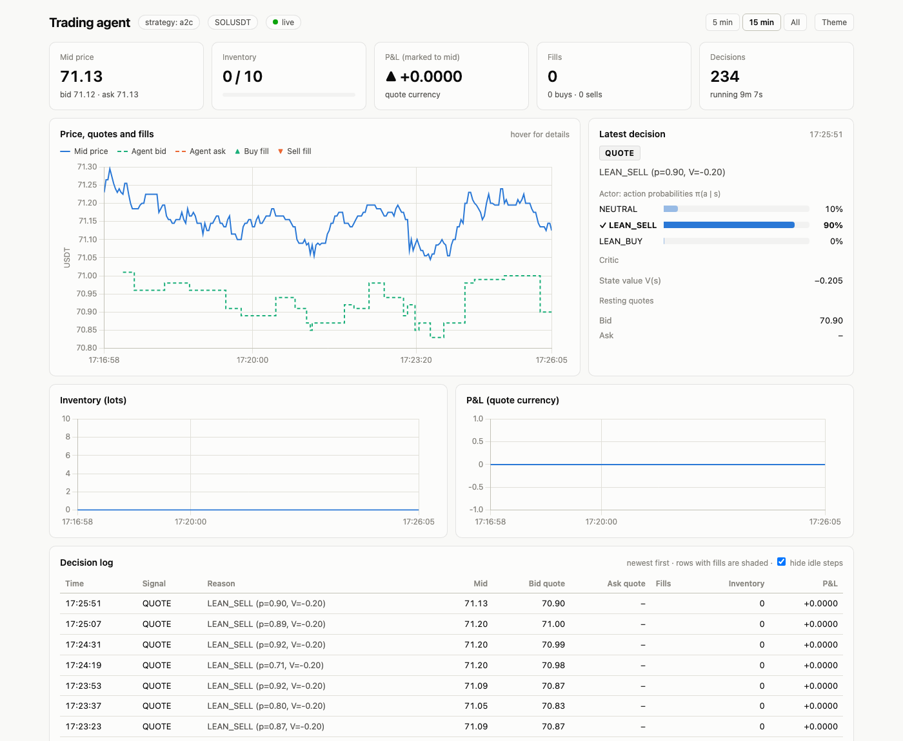
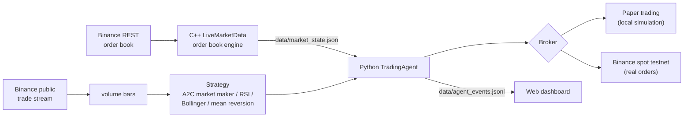
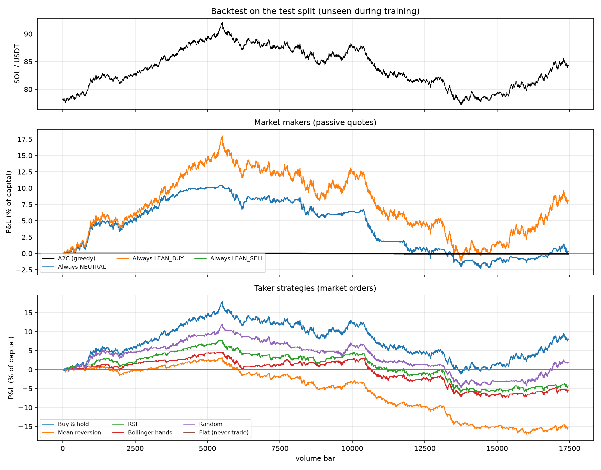
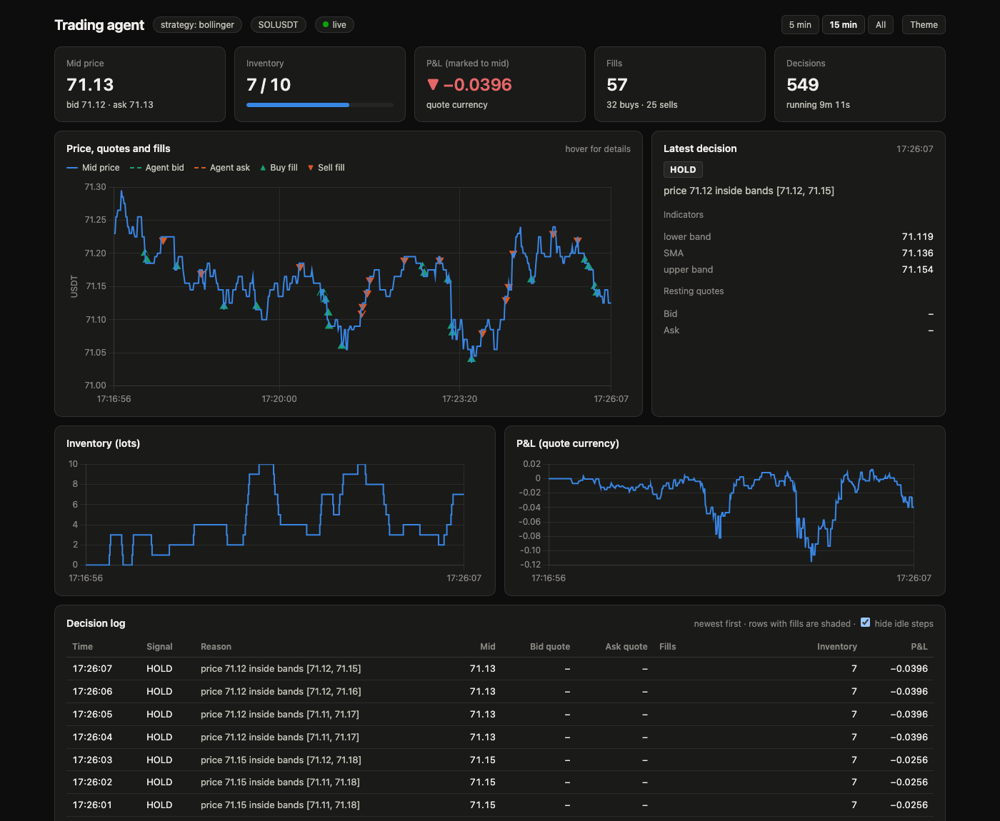

# RL Market Making on a C++ Order Book

An end-to-end algorithmic trading system: a **C++20 limit order book** fed by
live Binance market data, and **Python trading agents** (an **A2C
reinforcement-learning market maker** in PyTorch plus rule-based baselines)
that trade on a paper account or on the Binance spot testnet, with a live web
dashboard that shows every decision the agent makes.

Built as a school engineering project. The reinforcement-learning part
(environment, A2C training, backtesting, live market maker) is documented in
[docs/A2C.md](docs/A2C.md).



*Live dashboard while the A2C agent quotes on SOLUSDT: the mid price, the
agent's resting bid, the actor's action probabilities and the critic's state
value for its latest decision.*

## Highlights

- **Order book engine (C++20):** price-time priority matching, five order
  types (GTC, IOC, FOK, Market, Good-for-day), exchange rules (tick, lot,
  min-notional), live Binance snapshot ingestion, unit tests and a latency
  benchmark.
- **A2C agent (PyTorch):** actor-critic trained on 8.5 M real SOLUSDT trades
  aggregated into volume bars, with a market-making environment that uses a
  conservative fill model, fees and inventory risk.
- **One code path from training to live:** the same feature code builds the
  network's input in training, backtesting and live trading, and a unit test
  checks that live and training observations match.
- **Live dashboard:** every decision is logged as structured JSON and streamed
  to a web page with the price, quotes, fills, inventory, P&L and the agent's
  reasoning (A2C action probabilities and value, or indicator values for the
  rule strategies).
- **Honest evaluation:** chronological train / validation / test split, model
  selection on validation only, and comparison with constant-action and rule
  baselines across fee levels.

## Architecture



## Results (summary)




Held-out **test** split (last 15% of February 2026, never used for training or
model selection), fee 2 bps per fill:

| Strategy | Return | Max drawdown |
|---|---:|---:|
| **A2C market maker** | −0.05% | 0.05% |
| Constant "lean sell" quotes (≈ flat) | −0.01% | 0.01% |
| Constant symmetric quotes | +0.26% | 12.72% |
| Buy & hold | +7.97% | 19.15% |
| Bollinger bands | −5.48% | 11.98% |
| RSI | −4.32% | 13.91% |
| Mean reversion | −15.36% | 20.09% |

**This is a negative result, reported as such.** With a realistic fill model,
passive quoting on this data mostly runs into adverse selection: even with zero
fees, symmetric quoting loses money on the validation month. The A2C agent
converges to an almost-flat policy (99.5% of its actions are "lean sell"). That
policy matches, but does not beat, the trivial "stay flat" baselines. It
avoids the losses of the rule strategies on the falling validation month and
misses the rally in the test month. [docs/A2C.md](docs/A2C.md) covers the
experiments behind this conclusion and what would make the problem learnable
(order-flow features, continuous actions, more data).

## Quick start

Requirements: CMake ≥ 3.16, a C++20 compiler, Python ≥ 3.10.

```bash
pip install -r requirements.txt

# C++ engine: build + run the unit tests
scripts/build.sh

# Python unit tests
python -m unittest discover tests
```

### Run live (paper trading, no API key needed)

```bash
scripts/run_feed.sh SOLUSDT                         # terminal 1: C++ live order book
python -m agents.main --strategy a2c                # terminal 2: A2C market maker
python -m agents.main --strategy rsi                # ... or a rule-based strategy
python -m dashboard                                 # terminal 3: open http://127.0.0.1:8050
```

The dashboard works with every strategy. Here it is with Bollinger bands, which
trades much more often than the A2C agent:



To send real orders to the [Binance spot testnet](https://testnet.binance.vision),
export `BINANCE_TESTNET_API_KEY` / `BINANCE_TESTNET_API_SECRET` (see
`.env.example`) and add `--broker testnet`. (Testnet mode has not been
re-tested since the code was refactored; paper mode is the tested path.)

### Train and evaluate the A2C agent

```bash
scripts/download_data.sh SOLUSDT 2026-02            # from data.binance.vision
python -m agents.rl.train_a2c                       # ~35 s on a laptop CPU
python -m agents.rl.evaluate --split test           # tables + docs/figures/a2c_backtest.png
```

## Order book engine

| Operation (Apple M5, Release build) | Mean latency | Throughput |
|---|---:|---:|
| Cancel order | 0.03 µs | ~32 M ops/s |
| Match one incoming order against one resting order | 1.8 µs | ~556 k ops/s |
| Match one incoming order against 10 resting orders (same price) | 2.0 µs | ~499 k ops/s |
| Modify order | 23 µs | ~43 k ops/s |
| Add order (10 k inserts into an initially empty book) | 6.1 µs | ~164 k ops/s |

Run with `orderbook/build/OrderBookBenchmark`.

Design: bids and asks are `std::map<Price, std::list<Order>>` (best price at
`begin()`), and a hash map from order ID to list iterator gives O(1)
cancellation. Market orders are converted to aggressive limit orders so they
reuse the matching path.

**Known limitation:** after each match the engine scans every resting order to
expire IOC orders, so the cost of `AddOrder` grows with book size. Tracking IOC
orders separately would remove that scan.

## Project structure

```
├── orderbook/                  C++20 order book engine
│   ├── include/  src/          Core types, OrderBook, MarketData, LiveMarketData
│   └── tests/                  unit tests + latency benchmark
├── agents/
│   ├── main.py                 CLI: run a strategy live
│   ├── agent.py                trading loop (feed -> strategy -> broker)
│   ├── events.py               structured decision log for the dashboard
│   ├── brokers.py              paper broker / Binance testnet broker
│   ├── strategies/             A2C market maker + rule-based baselines
│   ├── rl/                     features, environments, A2C training, backtesting
│   └── exchange/               Binance REST clients
├── dashboard/                  live web dashboard (stdlib server + one HTML page)
├── models/a2c.pt               trained A2C checkpoint
├── docs/A2C.md                 RL write-up
├── tests/                      Python unit tests
└── scripts/                    build / data download / live feed helpers
```

## Acknowledgements

The order book engine is adapted from
[SLMolenaar/orderbook-simulator-cpp](https://github.com/SLMolenaar/orderbook-simulator-cpp)
(MIT, see [orderbook/LICENSE](orderbook/LICENSE)), reorganised into modules and
extended with the JSON market-state export, a benchmark and memory-safety fixes.
