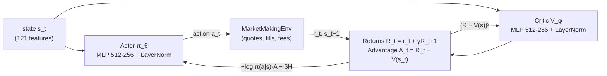
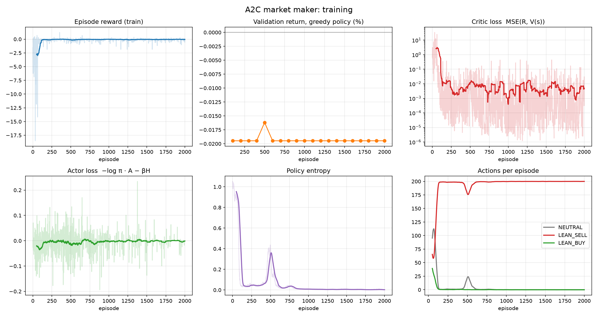
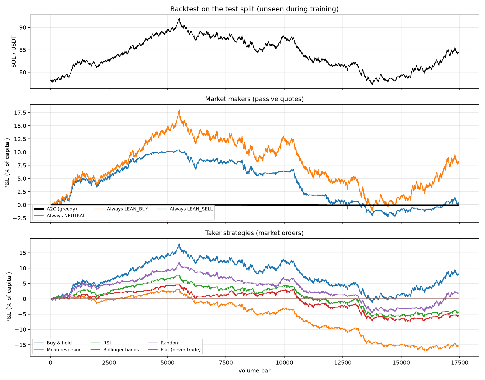

# A2C market maker

This document describes the reinforcement-learning agent in this repository:
how the problem is formulated, how the agent is trained and evaluated, and what
the experiments show.

## 1. Problem formulation

A **market maker** continuously posts a buy quote (bid) below the price and a
sell quote (ask) above it, and earns the spread when both get filled. The main
risk is **inventory**: if the price keeps moving in one direction, only one side
fills and the position loses value (adverse selection).

The agent controls *how to skew its quotes* around the last price:

| Action | Bid offset | Ask offset | Intent |
|---|---:|---:|---|
| `NEUTRAL` | −12.5 bps | +12.5 bps | symmetric quoting |
| `LEAN_BUY` | −5 bps | +30 bps | accumulate inventory |
| `LEAN_SELL` | −30 bps | +5 bps | offload inventory |

Constraints mirror a Binance **spot** account: long-only, inventory between 0
and 10 lots, an ask is posted only when there is inventory to sell.

### Data: volume bars

The data is Binance `aggTrades` for SOLUSDT, February 2026 (8.5 M trades).
Trades are aggregated into **volume bars** of 1,000 SOL (≈ 3 bars / minute).
Volume bars sample more often when the market is active, and their returns are
closer to i.i.d. than time bars. The data is split **chronologically**:

| Split | Bars | Price move |
|---|---:|---:|
| Train (70%) | 81,454 | 105.6 → 81.3 (−23%) |
| Validation (15%) | 17,454 | 81.3 → 78.2 (−4%) |
| Test (15%) | 17,455 | 78.3 → 84.3 (+8%) |

### State

121 features = the last 30 bars (close, high, low relative to the latest close,
and volume relative to its window mean) + current inventory / max inventory.
All features are scale-free, so the same network works at any price level.

### Fill model

During the next bar a bid is filled only if the price trades **through** it by
at least one tick (`low < bid − tick`), and similarly for the ask. Merely
touching the quote is not enough. This is a conservative stand-in for queue
position: with an optimistic "touch = fill" rule a market maker looks
profitable in almost any backtest.

### Reward

$$
r_t = 100 \cdot \frac{\Delta V_t - \lambda\, I_t^2\, P_t}{P_t},
\qquad V_t = \text{cash}_t + I_t P_t
$$

the mark-to-market P&L net of fees (2 bps per fill by default), minus a
quadratic inventory penalty (λ = 1e-5), expressed in % of one lot.

## 2. Algorithm: Advantage Actor-Critic



For each episode (200 steps from a random start in the training split):

1. Roll out the stochastic policy and store `(s_t, a_t, r_t)`.
2. Compute bootstrapped returns `R_t = r_t + γ R_{t+1}` with `R_T = V_φ(s_T)`, γ = 0.99.
3. Advantages `A_t = R_t − V_φ(s_t)`, normalised per episode.
4. Critic: minimise `(R_t − V_φ(s_t))²`.
5. Actor: minimise `−log π_θ(a_t|s_t)·A_t − β·H(π_θ)`, with the entropy bonus β decaying linearly from 0.02 to 0.001.

Adam (lr 3e-4 actor, 1e-3 critic), gradient-norm clipping at 0.5, 2,000
episodes (about a minute on a laptop CPU). Every 100 episodes the greedy policy is
backtested on the validation split, and the best checkpoint is saved together
with its feature settings (`models/a2c.pt`).

**Mirror augmentation.** Half of the episodes run on the training prices
reflected in log space (`p → p₀²/p`), so a down-move becomes an up-move of the
same size. The −23% trend of the training month then cannot be learned as a
shortcut.

## 3. Results



The policy converges within ~150 episodes to quoting `LEAN_SELL` (99.5% of
steps on both held-out splits): it keeps a bid 30 bps below the market, buys
only on sharp dips, and immediately offers that inventory back 5 bps above the
price. In practice it stays almost flat, and is functionally the same as the
constant `LEAN_SELL` baseline.

Backtest on the **test split** (never used for training or model selection;
returns in % of the capital needed for the maximum position, fee 2 bps):

| Market makers | Return | Max drawdown | Fills |
|---|---:|---:|---:|
| **A2C (greedy)** | −0.05% | 0.05% | 10 |
| Always `NEUTRAL` | +0.26% | 12.72% | 1,360 |
| Always `LEAN_BUY` | +8.05% | 19.18% | 28 |
| Always `LEAN_SELL` | −0.01% | 0.01% | 4 |

| Taker strategies (market orders) | Return | Max drawdown | Fills |
|---|---:|---:|---:|
| Buy & hold | +7.97% | 19.15% | 10 |
| Mean reversion | −15.36% | 20.09% | 6,596 |
| RSI | −4.32% | 13.91% | 2,470 |
| Bollinger bands | −5.48% | 11.98% | 1,452 |
| Random | +1.85% | 16.71% | 1,540 |



On the **validation split** (a falling market) the ranking reverses: A2C
−0.02%, always `LEAN_SELL` −0.02%, flat 0.00%, always `NEUTRAL` −6.99%, buy &
hold −4.29%, and every rule strategy loses between 1.9% and 14.4%
([figure](figures/a2c_backtest_val.png)).

**A2C does not beat the best constant action** on either split: it ties with
`LEAN_SELL` / flat on validation and is slightly behind them on test.

Fee sensitivity on the test split (strategy return):

| Strategy | 0 bps | 2 bps | 7.5 bps | 10 bps |
|---|---:|---:|---:|---:|
| A2C (greedy) | −0.03% | −0.05% | −0.11% | −0.13% |
| Always `NEUTRAL` | +3.18% | +0.26% | −7.76% | −11.41% |
| Always `LEAN_BUY` | +8.10% | +8.05% | +7.88% | +7.81% |

## 4. Discussion

**The agent learned to avoid risk, not to make money.** With a realistic fill
model, passive quotes on SOL volume bars suffer from adverse selection. Even at
zero fees, symmetric quoting loses 4.6% on the validation month. The
best-scoring behaviour on the training and validation data is to stay almost
flat, and A2C converges to it. It learns nothing beyond what a constant action
achieves. The return on the test split (the only
month that went up) comes from holding SOL, which a long-biased constant
policy or buy & hold captures, not from market making.

Experiments run before settling on this setup (all selected on validation):

| Variant | Outcome |
|---|---|
| Taker formulation (market BUY / SELL), 2 bps and 0 bps fees | collapses to never trading; lag-1 autocorrelation of bar returns is only 0.016, so there is little to predict |
| Market maker, no augmentation | collapses to `LEAN_SELL` (flat) |
| Market maker + mirror augmentation (shipped) | same behaviour, no meaningful difference on validation |
| Market maker, 0 fees, strong entropy bonus (β 0.1 → 0.01) | stays exploratory, but best validation return −0.15%, still below flat |

These experiments say more about the environment than about A2C. The next
steps that would make the problem learnable:

* **Richer state:** order-book imbalance, trade-flow sign and short-term
  volatility are the features that predict adverse selection; the current state
  only sees bar prices and volume.
* **Finer actions:** continuous quote offsets (e.g. PPO / SAC with a Gaussian
  policy) instead of three fixed skews.
* **More data:** several months covering different regimes, with walk-forward
  validation.
* **A better simulator:** replaying the order book with queue position
  instead of bar-level trade-through.

## 5. Reproducing

```bash
scripts/download_data.sh SOLUSDT 2026-02
python -m agents.rl.train_a2c                  # about a minute, writes models/a2c.pt
python -m agents.rl.evaluate --split val       # model selection numbers
python -m agents.rl.evaluate --split test      # held-out numbers above
```

Training is seeded (`--seed`), and results can vary slightly across PyTorch
versions and hardware.
